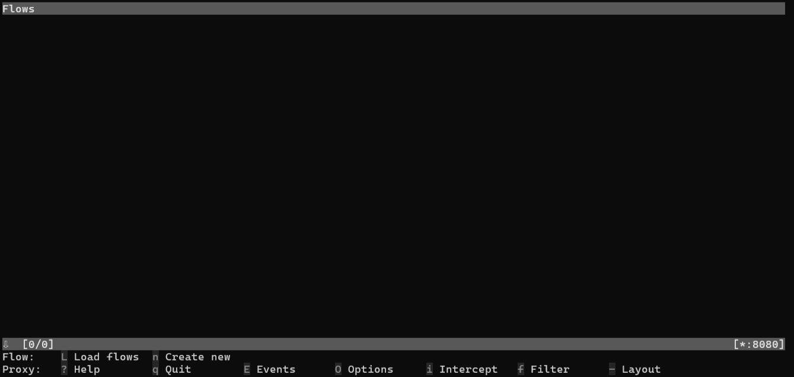
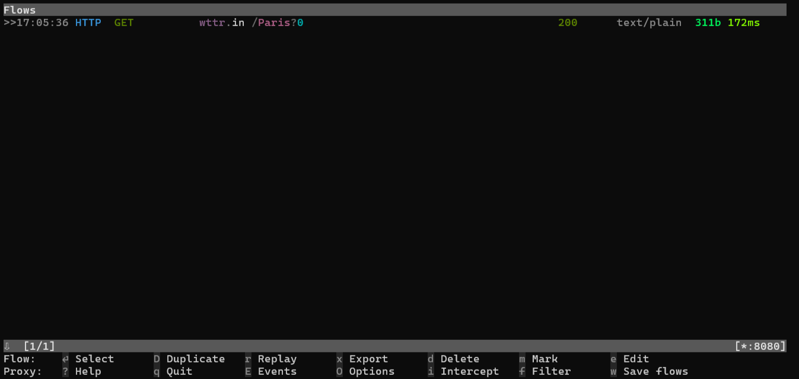
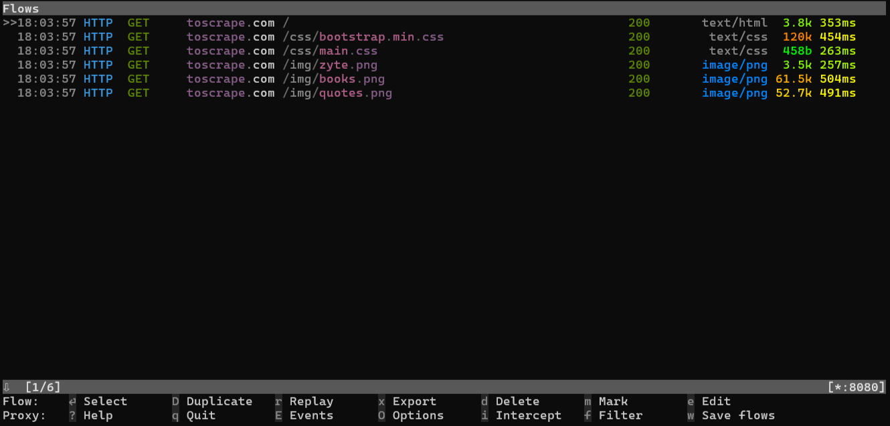

[](https://www.bright.cn/?promo=github15) 

# 如何在 Node.js 中使用代理服务器
了解如何在 `node-fetch`、Playwright 和 Puppeteer 中集成代理。你还将了解如何在 Axios 中使用 Bright Data 的[住宅代理](https://www.bright.cn/proxy-types/residential-proxies)。本指南也可在 [Bright Data 博客](https://www.bright.cn/blog/how-tos/nodejs-proxy-servers)上查看。

- [要求](#requirements)
  * [设置本地代理服务器](#设置本地代理服务器)
- [在 Node.js 中集成代理](#在-nodejs-中集成代理)
  * [使用 `node-fetch` 集成本地代理](#使用-node-fetch-集成本地代理)
  * [在 Playwright 中集成本地代理](#在-playwright-中集成本地代理)
  * [使用 Puppeteer 集成本地代理](#使用-puppeteer-集成本地代理)
- [在 Node.js 中集成 Bright Data 代理](#在-nodejs-中集成-bright-data-代理)
  * [住宅代理配置](#住宅代理配置)
  * [Axios 代理设置](#axios-代理设置)
  * [测试 IP 轮换](#测试-ip-轮换)

## 要求
确保你的计算机上已安装 Node.js。否则，请从[官方网站](https://nodejs.org/en/download)下载安装程序，启动后按照安装向导操作。

为你的 Node.js 项目创建一个文件夹，进入该文件夹，然后在其中初始化 npm 应用：
```bash
mkdir <NODE_PROJECT_FOLDER_NAME>
cd <NODE_PROJECT_FOLDER_NAME>
npm init -y
```

### 设置本地代理服务器
[mitmproxy](https://mitmproxy.org/) 是一款开源的交互式 HTTPS 代理工具。使用它来设置本地代理服务器。

按照[适用于你的操作系统的安装指南](https://docs.mitmproxy.org/stable/overview-installation/)安装 mitmproxy，然后启动它：
```bash
mitmproxy
```
将显示以下界面：

现在，你已经拥有一个在本地 `8080` 端口监听的代理服务器。使用以下命令进行验证：

```
curl --proxy http://localhost:8080 "http://wttr.in/Paris?0"
```
**注意**：在 Windows 上，请使用 `curl.exe`，而不是 `curl`。

结果应类似于：
```
Weather report: Paris

                Overcast
       .--.     -2(-6) °C
    .-(    ).   ↙ 11 km/h
   (___.__)__)  10 km
                0.0 mm
```

返回 mitmproxy 界面，你会看到它已拦截该请求：

## 在 Node.js 中集成代理
编写一个 Node.js 脚本，使用以下技术通过本地代理服务器连接网站：
* [`node-fetch`](https://www.npmjs.com/package/node-fetch)
* [Playwright](https://playwaright.dev/)
* [Puppeteer](https://pptr.dev/)

### 使用 `node-fetch` 集成本地代理
你需要使用 `http-proxy-agent` 库在 `node-fetch` 中配置代理。

使用以下命令同时安装它们：
```bash
npm install node-fetch http-proxy-agent
```
**注意**：`node-fetch` v3.x 是仅支持 ESM 的模块。请在 `package.json` 中设置 `"type"="module"`，以确保其正常运行。

使用 `fetch()` 方法通过代理服务器发送请求：
```javascript
// node-fetch-proxy.js

import fetch from "node-fetch";
import { HttpProxyAgent } from "http-proxy-agent";

async function fetchData(url) {
  try {
    // initialize the local proxy agent
    const proxyAgent = new HttpProxyAgent(
      "http://localhost:8080"
    );
    // connect to the target site through the
    // local proxy
    const response = await fetch(url, {
      agent: proxyAgent,
    });

    // retrieve the HTML returned by the
    // server and print it
    const data = await response.text();
    console.log(data);
  } catch (error) {
    console.error("Error fetching data:", error);
  }
}

fetchData("http://toscrape.com/");
```

### 在 Playwright 中集成本地代理
将 Playwright 添加到项目依赖项中：
```bash
npm install playwright
```

使用以下命令完成 Playwright 安装：
```bash
npx playwright install --with-deps
```
**注意**：这需要一些时间，因为它还会安装浏览器二进制文件及其依赖项。

创建一个 `playwright-proxy.js` 文件，并在 Playwright 中集成代理：
```javascript
// playwright-proxy.js

import { chromium } from "playwright";

(async () => {
  // create a Chromium instance with
  // the local proxy configuration
  const browser = await chromium.launch({
    proxy: {
      server: "http://localhost:8080",
    },
  });

  // add a new tab and connect to the
  // target page
  const page = await browser.newPage();
  await page.goto("http://toscrape.com/");

  // extract the HTML content of the page
  // and log it
  const content = await page.content();
  console.log(content);

  // release the browser resources
  await browser.close();
})();
```

### 使用 Puppeteer 集成本地代理
安装 Puppeteer：
```bash
npm install puppeteer
```

按照 `puppeteer-proxy.js` 脚本中的方式，将本地代理集成到 Puppeteer：
```javascript
// puppeteer-proxy.js

import puppeteer from "puppeteer";

(async () => {
    // pass the URL of the local proxy to
    // the `--proxy-server` flag to configure it in Chrome
    const browser = await puppeteer.launch({
        args: ["--proxy-server=http://localhost:8080"]
    });

    // open a new page and visit the target site
    const page = await browser.newPage();
    await page.goto("http://toscrape.com/");

    // retrieve the HTML content of the page
    // and log it
    const content = await page.content();
    console.log(content);

    // release the browse recources
    await browser.close();
})();
```

## 测试 Node.js 中的代理集成
使用以下命令启动 Node.js 代理集成脚本：
```bash
node <NODE_SCRIPT_NAME>
```

它们将输出以下 HTML：
```html
<!DOCTYPE html>
<html lang="en">
    <head>
        <meta http-equiv="Content-Type" content="text/html; charset=UTF-8">
        <title>Scraping Sandbox</title>
        <link href="./css/bootstrap.min.css" rel="stylesheet">
        <link href="./css/main.css" rel="stylesheet">
    </head>
    <body>
    <!-- omitted for brevity ... -->
```

mitmproxy 界面会记录脚本发出的所有请求。使用 `node-fetch` 时，只会记录向 `http://toscrape.com/` 发出的 GET 请求。使用 Playwright 和 Puppeteer 时，还会记录浏览器为加载页面的 JS 和 CSS 文件而发出的请求：

## 在 Node.js 中集成 Bright Data 代理
Bright Data 提供可自动轮换出口 IP 的[高级代理](https://www.bright.cn/proxy-types)。下面介绍如何在 Node.js 脚本中将它们与 Axios 集成。

### 住宅代理配置
[注册 Bright Data](https://www.bright.cn/cp/start) 即可开始免费试用。前往“代理与抓取基础设施”控制面板，并配置新的住宅代理。

获取以下凭据：
* `<BRIGHTDATA_PROXY_HOST>`
* `<BRIGHTDATA_PROXY_PORT>`
* `<BRIGHTDATA_PROXY_USERNAME>`
* `<BRIGHTDATA_PROXY_PASSWORD>`

### Axios 代理设置
安装 Axios：
```bash
npm install axios
```

按照下面的 `axios-proxy.js` 脚本，将 Bright Data 住宅代理集成到 Axios：
```javascript
import axios from "axios";

async function fetchDataWithBrightData(url) {
    // configuration to instruct Axios
    // to route the traffic through the specified proxy
    const proxyOptions = {
        proxy: {
            host: "<BRIGHTDATA_PROXY_HOST>",
            port: "<BRIGHTDATA_PROXY_PORT>",
            auth: {
                username: "<BRIGHTDATA_PROXY_USERNAME>",
                password: "<BRIGHTDATA_PROXY_PASSWORD>"
            }
        }
    };


    try {
        // connect to the target page
        // and log the server response
        const response = await axios.get(url, proxyOptions);
        console.log(response.data);
    } catch (error) {
        console.error('Error:', error);
    }
}

fetchDataWithBrightData("http://lumtest.com/myip.json");
```

### 测试 IP 轮换
使用以下命令运行 Axios 代理集成脚本：
```
node axios-proxy.js
```

`http://lumtest.com/myip.json` 是一个返回你的 IP 相关信息的特殊端点。

多次执行该脚本，你会发现每次都会获得来自不同位置的不同 IP。
